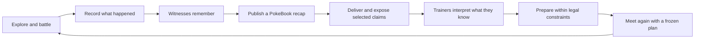
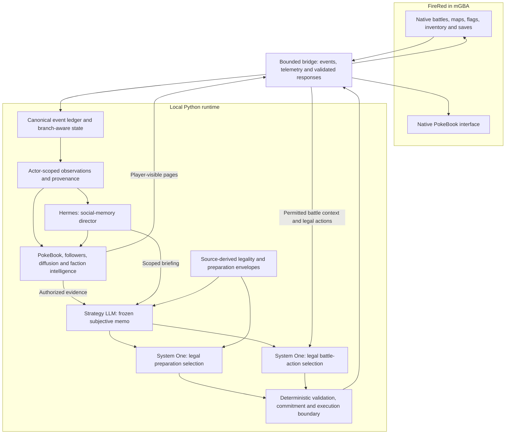

# Pokémon Influencer

### Your journey becomes the story everyone else is following.

Pokémon Influencer reimagines FireRed as a socially connected Kanto: trainers remember their encounters with you, share what happened on **PokeBook**, and form their own ideas about how to face you next.

A Bug Catcher's recap can become a Gym Leader's scouting report. A Rival can follow your public campaign without knowing what you keep private. A Rocket grunt can publish an ordinary post while passing a more detailed, legitimately observed report through a private faction channel.

The vision is a world of persistent people: recognizable companions, imperfect judgments, growing reputations, and encounters shaped by shared history. The familiar Kanto adventure remains the backbone, from choosing a starter through challenging the Pokémon League.

## The campaign loop



Early encounters create local chatter. As your following grows, news travels farther. Gym battles and other high-profile encounters attract broader attention, while dedicated scouts watch public battle reports independently of ordinary follower relationships.

That attention changes the information available to opponents. It does not grant them your hidden party, unrevealed moves, private inventory, or future decisions.

## PokeBook: the world's social memory

PokeBook combines a native in-game interface with a persistent information system. Posts, followers, observations, delivery receipts, and memories belong to the campaign's history.

Three distinctions define that system:

- **A post exists:** its author has published specific claims.
- **A post reaches a feed:** a particular actor has access to it.
- **An actor sees it:** an exposure receipt authorizes retaining those claims.

Public visibility is not universal knowledge. Reading the player's feed does not teach every trainer what happened, trigger new model calls, or generate campaign history. Distribution and NPC exposure follow their own event-driven rules.

Every supported completed trainer battle creates a mandatory recap obligation. Hermes gives that recap expression and continuity; deterministic publication services and factual fallbacks ensure it is recorded even when a provider is unavailable.

Followers are persistent relationships rather than a cosmetic counter. Following, familiarity, friendship, and rivalry remain distinct. A trainer can respect you, follow your journey, and still be irritated about losing.

## Architecture

The architecture separates native game authority, durable world state, scoped social memory, and bounded AI decisions.



### FireRed owns the game

The ROM remains authoritative for battles, movement, story flags, items, and native save serialization. Source integration uses FireRed's existing battle setup, party construction, action execution, scripts, and menu systems.

The bridge transports bounded facts and requests between the emulator and host. It correlates messages with build, campaign, branch, generation, session, and request identities; stale or mismatched responses cannot acquire authority by arriving late.

Network inference runs outside emulator callbacks and database transactions. Managed runtime health requires advancing native frames and fresh host telemetry, rather than merely a running process or connected socket.

### The host owns durable campaign continuity

The local Python runtime uses SQLite, append-only history, transactional projections, and durable jobs to maintain the social world around native gameplay.

Canonical facts, actor observations, public reports, private intelligence, and director memory have separate meanings and access paths. Retries use stable identities, and event acknowledgments follow durable commitment so reconnects can replay safely without duplicating domain effects.

### Hermes directs social memory

Hermes is the persistent social-memory director. It interprets completed battles, produces evidence-backed recaps, retains campaign continuity, and supplies scoped briefings or notes to NPCs.

Persistence lives in branch-aware game records, not an indefinitely growing model conversation. Fresh workers retrieve authorized durable memory, perform bounded work, and exit. Always-on availability means responding to meaningful campaign events, rather than continuously running inference or growing trainers according to wall-clock time.

Director knowledge does not automatically become trainer knowledge. An NPC receives information through a legitimate observation, public exposure, private delivery, or authorized briefing path.

### Strategy expresses intent

The Strategy LLM receives the trainer's authorized briefing, personality, current companions, inventory, and legal preparation envelope. It writes a concise, free-form **StrategyMemo** describing how that trainer wants to prepare and fight.

The memo is subjective. A trainer may overvalue a rumor, predict the wrong lead, or pursue an imperfect plan. Those judgments create personality without changing what the trainer owns or what the game permits.

The host stores the exact memo with its opportunity, context hash, branch, model provenance, and prompt version. Restarting the emulator or reopening PokeBook does not regenerate it.

### System One makes bounded choices

System One has two responsibilities:

| Responsibility | Inputs | Output |
| --- | --- | --- |
| Preparation | Frozen StrategyMemo, authorized facts, current resources, and validated preparation candidates | One supplied legal preparation candidate |
| Battle control | Locked preparation, the same StrategyMemo, permitted evolving battle context, and current legal actions | One supplied legal battle action |

System One follows strategy **semantically**. If a memo asks for an unavailable tactic, it can choose the legal option that best approximates the underlying goal. It cannot invent another candidate, grant a move, or create an item.

Requests distinguish **authorized facts** from **subjective strategy**. The game revalidates decisions before native execution. A model's confidence or eloquence never overrides legality.

The Puppeteer, Strategy, and System One model slots are independently replaceable behind provider-neutral interfaces. Recorded outputs support replay without calling the original provider again, while bounded deterministic fallbacks preserve continuity when a request fails.

## The information firewall

The core rule is simple:

> You beat Rick. Rick knows. Janice does not—until a legitimate delivery tells her something specific.

| Information layer | Meaning | Access |
| --- | --- | --- |
| Canonical world | What actually happened | Trusted game and host services |
| Direct observation | What a particular participant legitimately saw | That actor and explicitly authorized recipients |
| Public post | The claims an author published | Readers reached through delivery and exposure |
| Private faction report | Observed information shared through faction permissions | Authorized faction recipients |
| Director memory | Provenance-backed campaign continuity | Scoped Hermes jobs |
| StrategyMemo | A trainer's interpretation and intentions | Its bound encounter and decision services |

A public report remains a report, rather than becoming another trainer's personal observation. Repeating a claim does not create independent corroboration. Private Rocket intelligence stays outside ordinary public scouting.

## Adaptation with identity and limits

Preparation begins with the pinned FireRed source: encounter tables, version-specific habitats, level-up learnsets, TM/HM compatibility, evolution rules, trainer parties, and item mechanics.

Authored campaign policies then define what a particular trainer may do at a particular opportunity:

- Stage-based level targets and earned progression opportunities.
- Move-change budgets across existing companions.
- Native, nearby, accessible, and exceptional acquisition permissions.
- Finite supplies, acquisition allowances, and active-party capacity.
- Protected original companions and signature lineages.
- Gym themes and explicitly bounded support choices.

Evolution preserves an individual's lineage. Nearby means designated accessible neighboring territory; it does not mean every area connected through the map. Accessible and exceptional species require explicit permission.

The acquisition contract separates opening-stage improvement of existing partners from later acquisition allowances. Native/nearby weighting applies to eligible acquisition origins across opportunities, rather than imposing a quota on each finished team.

These constraints define a meaningful option space. Strategy supplies intent, System One chooses within that space, and deterministic services validate, account for resources, commit, and lock the result.

**Once committed, an encounter stays committed.** Later posts, player party changes, and provider recovery do not silently rebuild it. Balance changes apply to future opportunities rather than rewriting saved history.

## Saves, branches, and restart-safe preparation

A native save and its host world must represent the same campaign timeline. Paired checkpoints bind native identity to canonical and derived-state cutoffs, projection hashes, and branch lineage.

Restoring an earlier checkpoint excludes abandoned future memories, posts, and decisions. Records are not revived merely because a trainer name matches.

Pre-battle commitments use an explicit continuation contract:

```text
Immutable paired parent checkpoint
                │
                ▼
Committed StrategyMemo + locked preparation
                │
                ▼
Durable continuation with exact encounter identity
                │
                ▼
Fresh managed native session
                │
                ▼
Validate lineage, native compatibility and live telemetry
                │
                ▼
Reattach the same pending encounter
```

The continuation preserves logical commitments without pretending that host-side preparation proves native progress. Its parent remains immutable; restoration requires exact lineage and compatible native state. A new transport session is not a new preparation opportunity.

This gives ordinary trainers, Gym Leaders, Rivals, and faction encounters a shared durability model: no reinference, no reroll, and no history transplant.

## Repository guide

| Path | Purpose |
| --- | --- |
| [`pokefirered/src/`](pokefirered/src/), [`include/`](pokefirered/include/), [`data/`](pokefirered/data/) | Native FireRed source, integration hooks, and game data |
| [`bridge/`](pokefirered/bridge/), [`native/`](pokefirered/native/) | Host transport, managed session boundaries, and native integration support |
| [`world/`](pokefirered/world/), [`memory/`](pokefirered/memory/) | Canonical history, persistence, actor knowledge, and provenance |
| [`social/`](pokefirered/social/), [`virality/`](pokefirered/virality/), [`pokebook/`](pokefirered/pokebook/) | Relationships, distribution, exposure, faction intelligence, and player-visible views |
| [`puppeteer/`](pokefirered/puppeteer/), [`strategy/`](pokefirered/strategy/), [`system1/`](pokefirered/system1/) | Social director, subjective planning, and bounded decision providers |
| [`roster/`](pokefirered/roster/), [`content/`](pokefirered/content/), [`prep/`](pokefirered/prep/) | Source legality, authored policies, and preparation envelopes |
| [`battle/`](pokefirered/battle/), [`campaign/`](pokefirered/campaign/) | Battle decision orchestration and campaign integration |
| [`config/`](pokefirered/config/), [`schemas/`](pokefirered/schemas/), [`prompts/`](pokefirered/prompts/) | Versioned policies, contracts, and role prompts |
| [`tests/`](pokefirered/tests/), [`tools/`](pokefirered/tools/), [`evidence/`](pokefirered/evidence/) | Host checks, managed automation, and retained verification artifacts |
| [`agbcc/`](agbcc/) | Compiler source with upstream notices |
| [`PUBLICATION.json`](PUBLICATION.json) | Initial source-export provenance and file hashes |

Paths in the table are relative to `pokefirered/` unless shown otherwise.

## Read the design

- [Campaign vision and design](pokefirered/PLAN.md)
- [AI roles and authority](pokefirered/docs/ai_runtime_architecture.md)
- [Model provider contracts](pokefirered/docs/model_provider_contracts.md)
- [Preparation envelope](pokefirered/docs/preparation_envelope.md)
- [Public diffusion and private faction intelligence](pokefirered/docs/virality01.md)
- [Bridge, saves, and branch consistency](pokefirered/docs/bridge_and_saves.md)
- [Restart-safe pre-battle continuations](pokefirered/docs/prebattle_continuations.md)
- [Architecture decisions](pokefirered/docs/decision_log.md)
- [Build and toolchain instructions](pokefirered/INSTALL.md)

## Source and local inputs

The project builds on [`pret/pokefirered`](https://github.com/pret/pokefirered) with a pinned source/toolchain and a local desktop emulator plus companion runtime. Game authority remains native; hosted inference stays in the companion process.

ROMs, native saves, local databases, credentials, private runtime files, and generated build products stay outside version control. Supply required game inputs locally and keep provider credentials in local environment configuration. Upstream licenses and notices remain attached to their respective sources.
