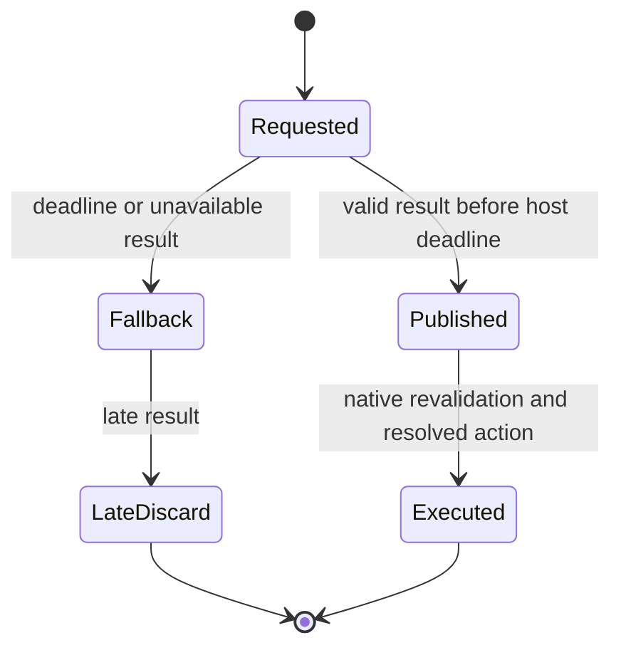
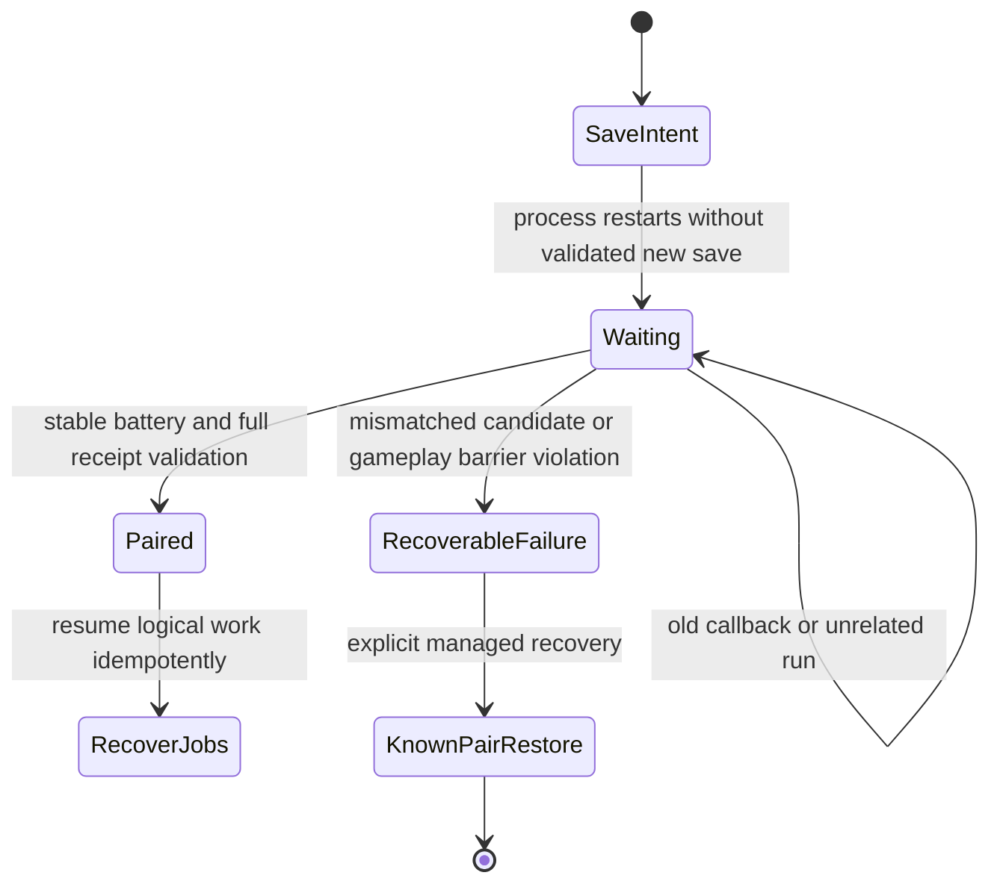

# CAMPAIGN-EXPANSION-01 gate repair — zero inference

Gate repair is **ACCEPTED under amended historical-evidence criterion B**.
CAMPAIGN-EXPANSION-01 itself remains unaccepted; live continuation is unrun.
This supersedes the earlier historical-evidence blocker without altering its records.
There were **zero hosted generation requests**. The closed 16-request ledger,
original C1 database/battery, Sally's accepted outputs and Rick/Brock history
remain byte-identical. Work used isolated SQLite backups and batteries.

## Greg preflight: what the evidence establishes

The historical Greg job constructed a production context, then committed fallback
with `diagnostics.failure=ProviderError`. There is no Greg POST, no Greg worker
error and no saved failed metadata response/error code. The parent Strategy path
raises ProviderError in configuration/free-route preflight before starting its
worker. That establishes the pre-worker boundary; it does **not** uniquely identify
which free-route predicate failed. A transient unhealthy endpoint is plausible,
but is an inference, not a recovered error receipt.

Metadata-only GET qualification now finds a healthy zero-price Nvidia text route
for the unchanged configured Nemotron model. No tool capability is required.
The saved Sally/Greg production requests serialize to 7,561/8,428 bytes; both
are below the 24,576-byte transport bound. Greg's four companions are valid.
No trainer-specific workaround or relaxed safety predicate was added.

`OpenRouterProvider.prepare_request()` now exposes the exact production serializer
and bounds as a pure preflight. The actual HTTP method uses that same function.
Campaign Strategy validates before creating a worker and logs the failing symbolic
preflight code or a successful request hash/provider names/input size. Neither
code path logs credentials. No historical memo has been regenerated.

| Actor | Context used for offline proof | Bytes | Knowledge | Native support |
|---|---|---:|---|---|
| Sally117 | saved successful production context | 7,561 | two authorized Brock claims | qualified native single |
| Greg106 | saved failed-job production context | 8,428 | two authorized Brock claims | qualified native single |
| James107 | isolated C1 production context | 7,530 | two authorized Brock claims | qualified native single |
| Kent108 | isolated C1 production context | 7,530 | two authorized Brock claims | qualified native single |

All resolve stable identities, distinct authored behavior/persona, own party,
empty finite resources, progression, PREP envelope and ordinary-text request.
No private director episodes, current opposing party/lead, or unobserved player
moves become authorized facts. Future James/Kent contexts must be rebuilt at their
actual opportunity with then-current delivered evidence; these are readiness
fixtures, not completed encounters. Native qualification/C tests cover the shared
hooks and actual source parties; live later encounters remain unrun.

C1 already contains Greg's immutable fallback memo and sole authored commitment.
The current context builder correctly rejects regenerating that consumed first
opportunity. Offline Greg qualification therefore reuses the saved production
context. A new live Greg memo at the same locked opportunity conflicts with the
preserve-history contract; the repair does not bypass that contract.

Evidence: `offline-preflight.json`, `strategy-*-{context,request}.json`,
`sally-greg-diff.json`, `current-strategy-route.json` in the gate evidence directory.
The exact historical cause remains UNKNOWN. The evidence gap is disposed through
explicit retained-artifact irrecoverability, not a reconstructed provider cause.

## Historical latency and timeout disposition

`historical-analysis.json` correlates ledger request hashes/scopes with recorded
host selections/native terminals and retains unmatched/missing fields explicitly.
HTTP duration includes network, request setup and ledger/parsing work; it is not
pure model compute. Provider acceptance, first-byte arrival and wall-clock native
execution were not recorded. Monotonic host timestamps cannot be treated as Unix
provider timestamps. The vertical-slice sample includes archived/abandoned trials.

| Recorded successful HTTP samples | n | min | median | p90 | p95 | max |
|---|---:|---:|---:|---:|---:|---:|
| Rick battle ledger | 9 | .595 | .628 | — | — | 1.687 |
| vertical-slice battle ledger | 89 | .419 | .635 | .799 | .927 | 1.990 |
| Sally | 12 | .459 | .614 | .748 | — | .779 |

Seconds; linear-interpolation percentiles require at least10/20 samples for
p90/p95 respectively. Rick has three requests without response receipts; Sally
has one. Recorded late-discard counts and matched host-minus-HTTP overhead are
in the artifact; absence of a timestamp is not evidence that an event never occurred.

Sally turn13 hit the fresh worker's `system1_request_deadline` at2.35 seconds.
The round trip did not finish, but provider compute versus network cannot be
separated. Turns14/15 made no POST: the failure latch suppressed them. That latch
was already changed to encounter scope in the preceding expansion work; its new
encounter regression remains covered. No Sally history is rewritten.

Keep provider2.35s, worker2.55s, host2.75s, ROM180 heartbeat frames (~3s at60Hz).
The observed successful maximum fits; increasing the wait to chase an unmeasured
outlier is unwarranted. Fast-forward reduces the native wall-clock allowance.
Fallback remains required, and reliability for new live encounters is unproven.



Host virtual-clock tests cover1s,2.749s,2.751s,9s and never-returning work against
2.75s. Native C tests compile actual pinned helper/overlay functions and cover
30/179/181/600 frames and no result at180. Before deadline external execution wins;
after deadline it cannot publish/execute, and host records one terminal disposition.
The full five-case emulator matrix now passes in disposable branch
353a69ed-d63a-4a48-81d4-24adaeb50941/session1852148969. One real native Greg encounter
was deliberately stopped before completion. Five legal player Growls45 preserved
all four opponents while exercising five normal decisions. Provider delays measured
1.005/2.655/2.855/4.005 seconds and never-returning work. Requests1/2 executed native
external Poison Sting40;3/4/5 reached native vanilla fallback and confirmed resolved
NPC actions40/81/81. Each has exactly one terminal lifecycle disposition. Late
results3/4 had no RESULT_PUBLISHED/native response;5 never returned before shutdown.
ROM heartbeat advanced from22749 through29163 while the never-returning worker was
outstanding; input/socket/event ACKs remained responsive. No BATTLE_ENDED, recap or
new follower was fabricated. `native-timing-matrix.json` retains exact receipts.
The test branch was backed up, abandoned and excluded by managed C1 restore; all
seven accepted C1 hashes returned. No actual campaign Greg qualification is claimed.

The writer now polls its socket at10ms while tactical work is active, retaining
200ms idle polling. This removes the unnecessary up-to200ms scheduling gap near
the host deadline. Hard timeout values remain unchanged. Work still runs outside
the writer and emulator callbacks. Historical BATTLE-01 delayed evidence is retained
in addition to these new emulator trials.

## Pending-save restart repair

A pending save is a durable `save_intents` row capturing campaign/branch/cursor,
nonce/run, last sequence, old fingerprint/counter. It is not a resumable HTTP
socket or proof that a native Save happened.

The original failure first replayed an old counter14 callback against an intent
expecting15. The host then suspended on a write during the barrier. Previously
native audit/lifecycle duplicates called `_writable` before duplicate detection;
a visible identical receipt could therefore trip the barrier. The historical host
log lacks the inbound envelope needed to uniquely identify that second call site.
Real-C1 tests reproduce this generic defect and prove its repaired behavior.

Visible identical native audit/lifecycle records can now return idempotently during
a barrier. Conflicting records and new writes remain rejected; restored future rows
are excluded by audit cursor/cutoff, and stale branches cannot commit. Constructor
transport also reconstructs its counter from visible durable installation receipts;
it accepts an identical known constructor receipt without incrementing it. Missing
or conflicting counter history still fails closed.

Save callbacks classify old-counter replay, unrelated run, unexpected counter, or
candidate before finalization. A candidate must still pass **every** existing
nonce/run/sequence/ACK/depth/state/drop/counter/battery/causal-cut check. Startup
processes callbacks before recovering writable jobs. Work waits explicitly while
a save is pending. Recap recovery uses existing deterministic settlement; interrupted
Strategy grants are revoked and recorded as waiting for future authorization.
Old worker results fail. HTTP sessions are never resumed. The runtime does not
silently grant another hosted attempt to an interrupted job.



Restart fixtures cover no pending work, queued recap, queued Strategy, pending
save and emitted/ingested-but-unACKed events. Posts settle once, duplicate ACKs do
not create history, old launch identities fail, and no fixture uses a hosted model.
Outbox notifications remain durable pending notifications, not inferred completion;
counts/types are reported in `coherence-cutoffs.json`. No blanket outbox clearing.

## Actual emulator proofs and protected C1

Fresh native Continue from isolated C1 opened Route3 and native PokeBook:
page1 Rick/Sammy/Brock, page2 Colton/Sally, followers Rick/Sally. All seven projection
hashes match accepted C1 before/after browsing. No inference/history replay.

The first new pending-save trial mistakenly started the save helper while Start
menu was already open. It did not save; gameplay during the barrier was rejected.
The screenshot/log/database are retained as a **failed trial**. No completed trainer
battle or accepted-history rewrite resulted. This establishes why the helper's
ordinary-field precondition and visually checked cursor matter.

The corrected trial began a save intent in the ordinary field, stopped the host,
restarted it, then performed the normal native Save. Actual callback counter16,
sequence/ACK0, empty queue/state/drops validated automatically to checkpoint
`7803161e-4d44-4747-8385-0e73e35d3201`. All seven C1 hashes remain identical.
A further fresh process/normal Continue from that test pair returned the real field,
with no pending save or active Strategy/Puppeteer job. This test checkpoint does
not replace the accepted original C1.

Original C1: checkpoint `0d802d18-55d0-4adb-9270-9baca47ed1b3`, cursor217,
campaign `a8c24607-48a7-4e47-a204-4221a7367fcc`, branch
`13a44cee-b272-40bb-9cfc-0815e1d386df`, counter15, fingerprint
`9b4d46a5c9623c9bcb54ccc42ba6fb7706a4301e5a8a86139fcc96aed3267776`.
C1 memory/social/puppeteer/PREP/Strategy/preparation-decision/battle-audit/virality
cutoffs:1810/25/43/23/8/752/294/1295. Source-backed battery flags: Colton105 and
Sally117 defeated; Greg106/James107/Kent108 undefeated. Actual batteries and source
serialization layout were used; no flag edits.

Evidence root: `evidence/phase6/campaign_expansion01_gate_repair/`.
Key proofs: `C1-native-readonly.json`, `native-pending-save-proof.json`,
`save16-fresh-projections.json`, `coherence-cutoffs.json`, `verification.json`.
Native screenshots are local/private `evidence/private/campaign_expansion01/gate*.png`.

## Validation and exact commands

```sh
.venv/bin/python tools/campaign_expansion01_gate_preflight.py
.venv/bin/python tools/campaign_expansion01_gate_analysis.py
.venv/bin/python -m unittest discover -s tests -p 'test_campaign_gate_*.py'
.venv/bin/python tools/battle01_c_tests.py --manifest evidence/phase6/campaign_expansion01/manifest-native.json
make -C .local/campaign-expansion01-native -j4
.venv/bin/python tools/verify_campaign_expansion01_gate_repair.py
```

19 focused gate/restart/diagnostic tests +137 relevant regressions =156 unique tests passed,0 skips.
The added diagnostic test covers six simulated failure categories and fresh process
reload; the other added test proves worker-to-parent diagnostic retention. Regression
suite patterns are campaign expansion, Strategy provider/memo, battle/end/System1,
world, Hermes domain and PokeBook; exact combined invocation is in the commands file.
Native C matrix passes. Build is an unchanged incremental build (`Nothing to be
done`), not a claimed clean rebuild. Actual ELF symbol triples match the preceding
accepted build: EWRAM end0x0203FFFC, headroom before4/after4/delta0. No native source
or permanent allocation changed. Stack/heap peak measurement remains outstanding.

## Historical evidence closeout — amended criterion B

**CAMPAIGN-EXPANSION-01 GATE REPAIR ACCEPTED.** The user attachment
`a56f32ee-bba4-4d8e-b400-28d28e7f088b/Pasted text.txt` amends only the unavailable
historical telemetry criterion: recover the cause OR demonstrate irrecoverability,
record UNKNOWN, verify the current path and prove repaired durable diagnostics.
Current functional/privacy/deadline/save/RAM gates remain unchanged.

Historical classification: **UNKNOWN — insufficient retained telemetry.** The
immutable causal trace retains Greg job/context, generic ProviderError and committed
fallback memo. There is no charged Greg POST or live model memo from that failure.
No exact HTTP status, response body, request ID, failed serving metadata or subtype
is retained. No specific historical remote cause is claimed. Current healthy metadata
and other actors' failures cannot reconstruct the old failed response.

`historical-error-search.json` enumerates104 retained experiment artifacts under
`evidence/phase6/campaign_expansion01/` and its `hermes-jobs/` subdirectory. Inspected
JSON/JSONL/text/log records include ledgers, causal/host/worker logs, native audits,
contexts, projections, delivery/pair/save logs and reports. Searches correlate Greg's
job/context and symbolic ProviderError/preflight codes. Only the generic class
survives; the old parent failure implementation persisted no specific diagnostic.
`greg-historical-incident.json` records exact paths and SHA256 of every searched file
and the immutable primary trace. Irrecoverability is bounded to retained project
artifacts, not a claim about provider-side external logs. Source artifacts remain
unchanged. No possible explanation is promoted to fact.

Current adapter request preparation passes saved Greg production context and current
James/Kent production builders with source identities/personas/party/resources,
scoped social facts, progression/PREP, ordinary-text prompt, encoding/size bounds,
configured free provider binding and no forced tools/JSON. Metadata is a recorded
snapshot, not a fresh live availability promise. Kent108 is the selected MtMoon actor.
Greg's consumed first opportunity correctly blocks rerolling; his saved memo/lock
is reused. The final live contract must preserve it.

Future diagnostic proof: actual Strategy adapter with mocked HTTP400, HTTP429,
timeout, network failure, malformed response and preflight/model rejection distinguishes
six categories without network or credentials. Safe symbolic codes, HTTP status,
job/model/provider, request stage/hash, timestamp/latency and context/scope bind errors.
HTTP timeout now remains distinct from transport failure. Worker stderr preserves
safe diagnostics into parent logging and guarded fallback memo history instead of
collapsing to bare ProviderError. Trusted parent scope carries actor/campaign/branch/
restore epoch/cutoff. Request IDs absent from the adapter are explicitly unavailable;
no provider prose, keys or full packet is persisted in diagnostics. Existing HTTP
error ledger sanitization remains separate. Logs are engineering incidents, not NPC
knowledge. Real memo commit/reopen, evidence reading and a fresh Python process reload
retain identical diagnostics for all six cases. Existing paired-save/Strategy tests
continue to enforce visibility and abandoned-future exclusion. No new save format,
checkpoint authority or NPC evidence path was introduced.

Proofs: `future-diagnostics.json`, `greg-historical-incident.json`,
`closeout-gate-tests.log`, `closeout-regression-tests.log`,
`closeout-native-tests.log`, `closeout-native-build.log`, `verification.json`.
Original154 tests remain passing; two new tests give156 unique tests,0 skips.
Real five-case emulator proof and C1/pending-save/fresh Continue evidence remain valid;
no emulator/model battle was replayed for this evidence-only closeout.

Final readiness: [campaign_expansion01_final_readiness.md](campaign_expansion01_final_readiness.md).
Proposed three-encounter ceiling98 (Strategy2/preparation0/battle84/Hermes12), **not
permission**. Greg first Strategy reroll/fourth content actor are contract conflicts
called out there. Full expansion remains unaccepted. Workers/listeners stopped,
closed16 ledger and all protected artifacts unchanged; hosted defaults disabled.
Permanent EWRAM headroom4/delta0 reconfirmed; stack/heap peak remains an open risk.
Next separately authorized task is the final live campaign continuation; no subsequent
phase, new acquisition, Rocket/Cerulean/Rival expansion or endgame implementation.
