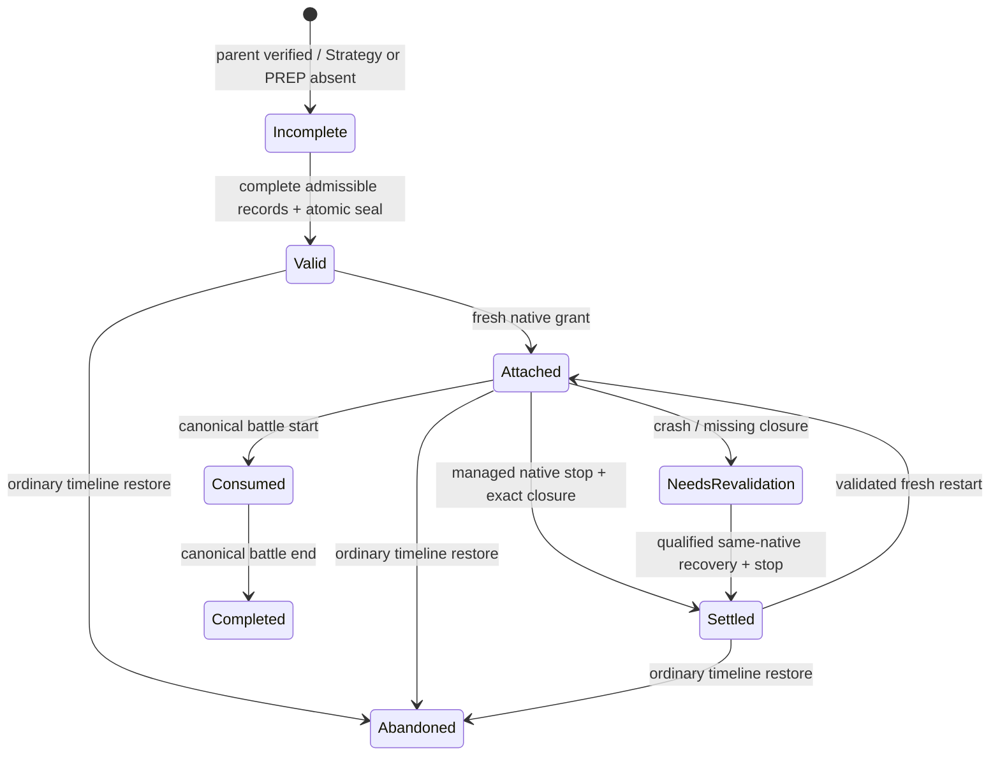

# Generic pre-battle continuations — v1 (2026-10-24)

A pre-battle continuation is a sealed **host-only descendant journal**, not a paired gameplay checkpoint. The paired parent remains immutable. The journal references existing append-only Strategy/PREP/decision receipts; restoration never copies receipts, selects a party, runs inference or changes the parent's saved cutoffs.

## Chosen model and boundary

Use modelB from the RIVAL-01 request. A new paired save (modelA) would require a genuine new normal native save and pairing, absent in this retained incident. The older `NativePreparationStore.resume_unpaired_preparation` only permits selection/commitment after already-paired Strategy/PREP; it correctly rejects these later Strategy/PREP records. The generic journal extends the shared checkpoint/launch API without weakening that older path or ordinary rollback.

The continuation requires the complete current descendant database, its immutable parent, and exact compatible native save. It cannot recover missing receipts from its serialized descriptor alone. Its receipt payloads are integrity references, not permission to import or replay abandoned history. A normal parent restore abandons existing valid continuations and retains its original seven projections. An explicit continuation launch validates the still-active descendant and creates a new transport grant **without invoking ordinary rollback**. No derived view cutoff is raised to resurrect data.

V1 native equivalence is deliberately strict: `managed-menu-no-gameplay-v1`. A trusted local integration/operator review must establish the last native state was the managed pre-Continue menu, with controlled accepted inputs, exact parent save identity, authenticated source session, zero captured/ACK/depth/drop counters and no later accepted gameplay. Hashed evidence anchors that review. A boolean/checksum alone is not the proof. Models cannot issue these receipts or call continuation APIs. Arbitrary field-state divergence is unsupported; it needs a compatible durable native checkpoint or separately qualified native-equivalence capture.

No trainer IDs, model slugs, trainer names or Rival special cases appear in the production journal implementation. Typed encounter identity, registry families and persistent companion origins bind an opportunity. Different Rival definitions sharing an actor are not interchangeable. The schema can represent ordinary/Gym/Rival/Rocket/rematch commitments; additional field-boundary/content qualification remains necessary outside v1's tested boundary.

## Shared API

`ContinuationMixin` is part of `PreparationDecisionStore`, inherited by campaign stores:

- `create_prebattle_continuation(parent_id, actor, native_trainer, opportunity, save_identity, native_proof)` seals complete eligible work atomically. Duplicate identical sealing returns the same content-derived ID. It refuses a conflicting valid continuation.
- `authorize_continuation_launch(id, nonce, save_identity, actor, native_trainer, opportunity)` validates the active descendant and grants a fresh immutable native origin. Previous launch aliases become inactive; domain history and original Strategy epochs stay intact.
- `continuation_encounter(...)` returns the exact resolved memo and preparation. It does **not** call planning `recorded_strategy`, which correctly cannot reconstruct an already-spent PREP opportunity.
- `settle_continuation_session(origin, save_identity, native_witness)` records a trusted managed shutdown after native freeze/stop. An unresolved prior native session blocks fresh restart. Absence of canonical events alone is insufficient after a crash.
- `continuation_catalog()` distinguishes paired gameplay checkpoints and pre-battle continuations with explicit valid/abandoned/consumed/completed status. Incomplete candidates fail before sealing with `COMMITMENT_INCOMPLETE`; invalid candidates return specific validation errors rather than appearing as paired saves.

Schema1 is additive and created only by explicit journal operations. Historical databases without it open unchanged. Unsupported future versions are rejected on store open and API access. Descriptor/IDs and session/closure records are immutable; status changes are recovery metadata. Sealing and grant creation use the existing serialized FULL/WAL transaction path. The descriptor is durable at transaction COMMIT. No callbacks perform network work.

## Admissibility

The shared validator requires exact normal parent/save/build identity; active same campaign/branch/canonical cutoff, no pending fork/save or active battle; unchanged memory/social/director/virality prefixes; matching actor/native registry and typed encounter; original opportunity/Strategy/context hash and committed legal lock; no installation/consumption; no pending model/recap jobs. Allowed post-parent receipt tails are restricted to that opportunity's Strategy records, explicit content/actor initialization and exactly its decision/commitment. Arbitrary progression, other actors' commitments and native provenance tails fail closed.

All seven current view bindings, the content version, full frozen memo/lock and exact receipt tails are sealed. Fresh launch validates them again, including original context/policy provenance. This applies equally to live and fallback memos. Resources/lineages stay frozen under the existing commitment. No reinference, new candidate enumeration, equivalent-party substitution or provider-state update is allowed.

Crashes before sealing provide no continuation authority; complete retained records can later be explicitly sealed without regenerating them. Interrupted validation/grant rolls back. A crash after grant without native closure yields `PRIOR_NATIVE_SESSION_UNSETTLED`. Once canonical gameplay consumes the journal, pending-encounter reattachment is prohibited; recover through compatible normal gameplay checkpoints. Ordinary rollback never grants a sibling/abandoned generation permission to reuse the journal.

## Native readiness

The accepted shared launcher can receive `continuation_id`. The generic offline qualification wrapper uses it, with no model/tactical services. Managed supervisor starts the host connection loop before the emulator. Lua establishes exact build/nonce/origin/run identity. Host `Health` ingests the existing source-bound native telemetry and records increasing **existing emulator frames**. Input is allowed only after real progression reaches the host; process/window/socket/file timestamp alone is insufficient. Regressing, wrong-session, stale, dropped/gapped or stationary telemetry never establishes readiness.

The one-second active freshness/progression guard remains fail closed. Startup host readiness is bounded15 seconds; the pre-existing bounded600-second Lua startup allowance remains, with no gameplay lease before proof. No elapsed timeout grants success. Existing exactly-once/ACK-after-commit/stale-event rules are unchanged. Explicit same-native reconnect waits for the replacement writer, then requalifies progression before restoring input.

The retained mGBA sample was waiting in audio production. The qualified isolated launcher uses `audioSync=0`, `videoSync=1`, `fpsTarget=59.7275`, with no turbo/fast-forward. The pinned Qt source paces synchronized video frames; actual native telemetry confirms normal progression and successful SIGSTOP/SIGCONT reconnect. This removes reliance on the stalled audio producer; it is not a claim to have established every underlying macOS audio cause. All changes are host/Lua-diagnostic/launch-side, with zero permanent native memory growth.

See [actual RIVAL-01 qualification](rival01_prebattle_continuation.md), which includes the retained-record admission, two fresh normal Continues, failure matrix, code/test evidence, original-file preservation and remaining limits.
