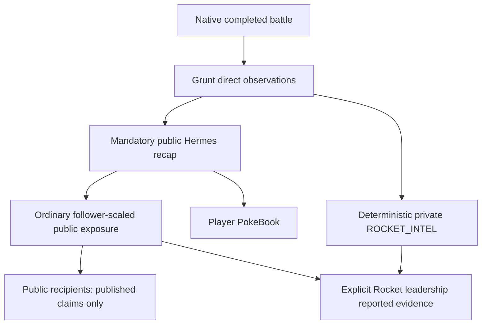

# ROCKET-01 — accepted under D50; historical live-Hermes failure retained

**Current: ACCEPTED under D50.** The historical result below is retained unchanged. The separate repaired live qualification was discarded; the real fallback remains authoritative. See [disposition](rocket01_hermes_disposition.md).

User a0b57b8b authorizes one live first natural Mt. Moon Rocket encounter and private faction intelligence. No leadership inference/battle, acquisition, Cerulean, Rival, ordinary architecture expansion or endgame. New aggregate ledger ceiling50: Strategy4/preparation4/battle36/Hermes6; verified free only. Normal inference remains disabled.

Start is accepted post-Kent checkpoint `fc4b6afd-9935-4cbb-b248-72c2b454b436`, campaign `a8c24607-48a7-4e47-a204-4221a7367fcc`, branch `13a44cee-b272-40bb-9cfc-0815e1d386df`, cursor398, native Save18. Fingerprint `eef3fcaea1563645e09bd9537aea0eb16ff648682dceaa24ec0f86aa8cd0714d`. SQLite read-only backup and intact battery copies in `.local/rocket01/`; originals remain untouched. Exact starting hashes: `evidence/phase7/rocket01/starting-pair.json`.

## Source encounter

Selected native352 / actor `trainer:fr:trainer:0352`, `TRAINER_TEAM_ROCKET_GRUNT_2`, class `TRAINER_CLASS_TEAM_ROCKET`. `MtMoon_B2F_EventScript_Grunt2` launches the ordinary native single; object(18,27) faces down with sight4. Party is Sandshrew27, Rattata19, Zubat41, each level11, source-default moves; zero held/battle items. Full source/party/move provenance is `config/rocket_content.json`, bound to pret037335f4c725d7c9aecdac87066f2002b4bd7e14 and the accepted catalog.

The retained field position is MtMoon1F(7,30). Source collision walk distances to descending ladders are38 at(31,16),70 at(19,14),100 at(5,6). The nearest first descent enters B1F(43,21), whose isolated corridor leads to B2F(17,31) and Grunt2. The other branches lead to different grunts; numeric trainer351 is not the first geographically reachable descent from this save. Selection precedes gameplay and does not optimize for an easier opponent:352 has three companions. No replay of Sally/Kent or native state edits.

A versioned additive Rocket content adoption preserves the ordinary pack/config hash and every prior lock. First preparation is sole source baseline: no growth, teaching, catches or spending. Hostile follow policy is explicitly `excluded-hostile`, preserving the previous default exclusion; a recap/intelligence does not require a follow. Native qualification changes ROM header rows only; generic combat source unchanged. Actual build `ba63f1ab18dd4370c093b1f3bd4156227c409dedd9bb1e68a799fad0fe80e357`; all EWRAM/IWRAM symbols identical, delta0, headroom4, identical save layout. Manifest/build/memory evidence in `evidence/phase7/rocket01/`.

## Information boundary



The existing automatic VIRALITY service is reused; no LLM produces private intel. Contract: [rocket_intel.md](rocket_intel.md). A complete report means every legitimate direct memory receipt of this completed battle, including repeated source observations; it does not grant unsupported item/status/switch claims or hidden party/stats/RNG. Independent public and private receipts may support the same semantic claim, preserving their separate provenance.

## Retained live result — blocked on live Hermes submission

**ROCKET-01 is not accepted.** Native352 completed with player victory at turn10, canonical battle `f1b18e98538e228b826b57d3af75d37ee80fc9cfe87a7a6c00476e09f17375a2`, terminal event `30939b2ad756fa14cbbf9784c26a4ff1d6402ba4b9824d90c63474e9d7bba815`, cursor443. Normal player buttons, three ordinary wild escapes while traveling, no cheats, savestates or battle replay. The original accepted Kent files/config/ledger hashes remain unchanged (`shutdown.json`).

Dots/AtlasCloud produced the actual frozen memo `strategy-memo:4f37bb7cb529336adb9434a68de51d269905574e6e449d7e0508aa9753c8089c`. Sole source-authored candidate bypassed preparation inference; commitment `commitment:0338fde83b08007eb7be56a2ccb200f8979dd80d97b3683077d4544e9d8e6918` was installed through the generic native constructor. Its three level11 partners/items/moves remain source bounded. Mercury/Inception served eleven meaningful decisions; all eleven have REQUESTED → RESULT_PUBLISHED → CONTROLLER_EMITTED → EXECUTED receipts, no fallback. One sole replacement needed no model call. EXECUTED means native action resolution, not a guaranteed hit/effect: faint and sleep still apply. Exact packets, selected legal IDs, latency/cost diagnostics and receipts are retained in `turn-1929702381-*.json`, `battle-audit.jsonl` and `post-rocket-pair.json`.

Private delivery succeeded independently: **47 direct receipts, seven distinct supported claims, 47 exact reported receipts to Giovanni348**. Every delivered claim equals its immutable parent; Giovanni's attribution is reported from352, not firsthand. All delivery cursors are443, and all reports committed before the first Hermes POST. No manual send or internal-intelligence inference occurred. Report completeness covers the current legitimate direct-memory schema, not unsupported raw state. The offline leadership evidence projection separates public information, ROCKET_INTERNAL_INTELLIGENCE and UNKNOWN; no leader Strategy job or qualified preparation envelope was created.

Hermes made **four actual free calls**: one evidence retrieval, then **three invalid result submissions**, all missing required `result.schemaVersion`. The sent tool schema required it. Strict validation rejected each proposal; the four-call job cap prevented a fifth POST. The mandatory deterministic fallback published `0a52bf795e9561ed4f85b5f5b9a797e2ef11c9185284876a899e515631973531` with outcome and observed Ivysaur. This is a real durable public post, **not a successful live Hermes recap**. Missing version is established by retained payloads; generic runtime errors are not misclassified as HTTP/provider outages. No field was patched into the historical response, no validator relaxed, and no fallback rerolled. See `hermes-failure.json` and request outcomes13–16. The actual live-Hermes acceptance gate remains blocked.

Public distribution remained ordinary, district tier, five player followers, Mt. Moon origin: twelve ordinary-discovery recipients plus54 chronically-online public scouts. Those66 recipients received only the two published claims. Private47 are excluded from public reach counts; Giovanni's public and private paths remain separate. Grunt following is excluded by explicit hostile content policy; followers remain five. Exhaustive configured-actor comparison and tested denial paths cover ordinary trainers, non-Rocket Gym/public scouts, Rival and member-without-leadership.

| Actual supported claim | Grunt direct | Public post | Public recipient (Ben89) | Giovanni private |
|---|---|---|---|---|
| Battle participation | yes | no | no | yes |
| Player victory / grunt loss | yes | yes | yes | yes |
| Ivysaur seen | yes | yes | yes | yes |
| Vine Whip22 revealed | yes | no | no | yes |
| Growl45 revealed | yes | no | no | yes |
| Leech Seed73 revealed | yes | no | no | yes |
| Sleep Powder79 revealed | yes | no | no | yes |
| Unseen party, unrevealed moves, hidden stats/RNG, unsupported items | no | no | no | no |

The strict superset is real **fallback** disclosure evidence; it is not presented as Hermes's editorial choice. Typed fixtures separately prove disclosure asymmetry and loss reporting. Machine-readable matrix includes all47 underlying observation IDs and private parents: `observation-matrix.json`. The causal trace links actual checkpoints, memo, battle, terminal, obligation, fallback producer, public exposure IDs and private receipt IDs: `golden-causal-trace.json`.

## Save, viewer and rollback

Native Save20 is a **normal managed pair**, checkpoint `fc2eb9f8-d613-4f48-aebf-b2ffa2c44824`, same campaign/branch, cursor443, fingerprint `8d07886f33eea4d863209f9be626c191f4cf475262ceb5db5c3951f0f1c7d435`, content hash `665e893fd9c8815fe04e041e614ca5e61d877c4a0dfe0e5a09a73c447bc322e0`. Retained private pair: `.local/rocket01/post-rocket-pair.sav` + `post-rocket-pair.sqlite3`. Actual savedataUpdated receipt/intent/checkpoint are in `save-receipts.jsonl`/`pairings.jsonl`/`post-rocket-pair.json`; no retrospective pairing.

The first post-battle save navigation used the wrong menu cursor and opened the Pokédex. A premature retry was still inside its submenu and also failed. Both timeouts are retained, not labeled saves. Native B navigation returned to the verified field; the same pending intent `02f31dc7-b033-49c5-95c9-f4f348158197` was resumed, and Save20 paired normally. Helpers require a verified field and actual menu cursor, not merely an assumed screenshot label.

Two complete native viewer traversals show all11 public posts and actual followers, including the grunt's fallback recap on the last feed page. Private intel never appears. Both traversals preserved all seven replay hashes and request ledger bytes. Fresh OS-process mGBA Continue was actually advanced through title/Continue to MtMoon B2F(18,31); `rocket-reload-field.png` is the field proof. The earlier `rocket-fresh-continue.png` remained at title and is not used as a successful native reload. `post-rocket-reloaded.json` and `rocket-reloaded-viewer-proof.json` show identical memo/locks, public/private IDs and seven replay hashes with no new hosted attempts.

Isolated SQLite copies restore both accepted Save18 and pre-grunt Save19: future grunt observations, public post and private reports vanish; stale internal-work scope is denied. Save20 restores exact seven-layer hashes. Repeated internal processing retains the same report identities. An initial audit mistakenly compared all scheduler hashes after an extra tick on the working copy; tick bookkeeping can change without duplicate reports. That assertion failed honestly. The corrected retry audit runs only on private copies and compares delivery identities; a fresh Save20 restore discarded the unsaved audit tick. It did not alter canonical battle history or the retained normal pair.

## Checks, commands and stop condition

Focused final host tests:12; ordinary VIRALITY regressions:30; native battle/terminal/System One host regressions:23; PokeBook host regressions:16; campaign regressions:43. These are host tests, not additional game playthroughs. Logs are in `evidence/phase7/rocket01/`; exact commands are below. RAM build checks remain delta0/headroom4; no peak stack/heap claim is made.

```sh
# Repository root: /Users/blevicki/Documents/poke/pokefirered
.venv/bin/python tools/rocket01_content.py --write
.venv/bin/python tools/rocket01_build.py
.venv/bin/python tools/rocket01_preflight.py
# Live host used tools/rocket01.py host with --live. Its historical duration
# option was not retained as argv; live request/worker diagnostics are retained.
# Source-derived route and every ordinary button command are recorded in
# *-route.json, input-commands.jsonl and emulator.jsonl, including failed navigation.
.venv/bin/python tools/rocket01.py save --label rocket-paired-save --menu-cursor 0 --resume-intent
.venv/bin/python tools/rocket01_capture.py post-rocket-pair --battery
.venv/bin/python tools/rocket01_viewer.py --label rocket-viewer --cursor 4
# Stop tracked host/emulator first; launch.prepare refuses a running emulator.
.venv/bin/python tools/rocket01.py launch --restore .local/rocket01/post-rocket-pair.sav
.venv/bin/python tools/rocket01.py host --seconds 900
.local/mGBA.app/Contents/MacOS/mGBA -C hwaccelVideo=0 -C savegamePath=/Users/blevicki/Documents/poke/pokefirered/.local/rocket01 /Users/blevicki/Documents/poke/pokefirered/.local/rocket01-native/pokefirered.gba
# Native GUI Tools → Scripting → File → Load recent script → .local/rocket01/run.lua
.venv/bin/python tools/rocket01.py input --label rocket-reload-start 'key 3 8 120'
.venv/bin/python tools/rocket01.py input --label rocket-reload-menu 'key 9 0 180'
.venv/bin/python tools/rocket01.py input --label rocket-reload-field 'key 0 8 360' 'key 1 8 120' 'key 9 0 180'
.venv/bin/python tools/rocket01_capture.py post-rocket-reloaded
.venv/bin/python tools/rocket01_viewer.py --label rocket-reloaded-viewer --cursor 0
.venv/bin/python tools/rocket01_verify.py --clone-name rollback-audit-close
.venv/bin/python -m unittest discover -s tests -p 'test_rocket01.py'
.venv/bin/python -m unittest discover -s tests -p 'test_virality01.py'
.venv/bin/python -m unittest discover -s tests -p 'test_*battle*.py'
.venv/bin/python -m unittest discover -s tests -p 'test_pokebook01.py'
.venv/bin/python -m unittest discover -s tests -p 'test_campaign*.py'
```

Launch/build refuse overwrite; verifier clone names must be unused. In-game input remains bounded test automation, not game-domain state injection; the optional player probe was disabled and never armed. The first Hermes preflight mistakenly required forced tool_choice, which the actual harness does not use; it was corrected to actual tools/max_tokens and all required free routes qualified before any POST. That failed GET-only check remains retained.

**16/50 charged attempts**, all retained zero cost: Strategy1, preparation0, battle11, Hermes4. Ledger is closed with evidence-derived outcomes, unused34 not spent. Workers stopped, disposable owned Hermes home cleaned using its guarded cleanup API, normal hosted inference disabled. `verification.json`, `runtime-cleanup.json`, `shutdown.json` establish this disposition. No model changes, paid fallback, leadership inference/battle, acquisitions or endgame work.

Next narrowly scoped task is the **ROCKET-01 Hermes acceptance disposition**: address the missing-version failure without rewriting this committed public outcome or replaying the real battle. No further calls are started under this result. Post-Rocket milestone selection/readiness remains conditional on acceptance; Cerulean/Rival/acquisition/leader work is not authorized by this partial result.

Global `git diff --check` returns2 for pre-existing `src/new_menu_helpers.c:670` trailing whitespace. ROCKET-01 did not change that line; task-added files pass a separate whitespace check. This is recorded as a failed global check, not a passed test.
